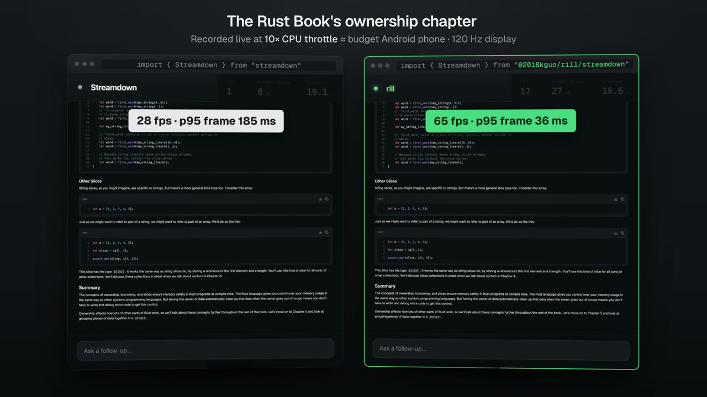

# rill

**A drop-in replacement for Streamdown that's much faster. Same DOM, byte for byte.**

rill is a drop-in for [Streamdown](https://github.com/vercel/streamdown) 2.7.1, the
Markdown component behind a lot of AI chat UIs. Change one import and the same component
renders the same page, down to every class, attribute and text node, doing a fraction of
the work. On a throttled phone profile, long chats open 4 to 8 times sooner and answers
stream without stutter.

[](https://github.com/2018kguo/rill/releases/tag/v0.2.0)

*The launch film (70 s, real recordings): [watch it on the release page](https://github.com/2018kguo/rill/releases/tag/v0.2.0).*

## Use it

```sh
npm install @2018kguo/rill
```

Change one import:

```diff
- import { Streamdown } from "streamdown";
+ import { Streamdown } from "@2018kguo/rill/streamdown";
```

If you highlight code with `@streamdown/code`, change that import too, and the page
stops shipping Shiki (rill's highlighter gives the same colors):

```diff
- import { code } from "@streamdown/code";
+ import { code } from "@2018kguo/rill/code";
```

`@2018kguo/rill/streamdown` exports everything `streamdown` exports, with the same props
and behavior: copy and download buttons, table menus, the link safety modal, the caret,
server rendering and hydration, `components` overrides and `plugins`.

**Next.js** (Turbopack or webpack), **Vite 8** and **React Router** need no config.
**Vite 7 and older** need one plugin (`rill()` from `@2018kguo/rill/vite`), and **bun
build** needs the highlighter's WebAssembly URL. See
[Setup per bundler](docs/reference.md#setup-per-bundler).

## How much faster

Chromium with a phone-sized screen and the CPU throttled 10×, Streamdown 2.7.1 vs rill
0.4.0, the same final HTML on both sides; medians of interleaved runs:

| Scenario | Finished sooner | Less main-thread JavaScript | Stutter (long-frame blocking) | Memory after |
|---|---:|---:|---:|---:|
| Open a chat of 18 long answers | 4.4× | 6.6× | 6.1 s → 1.4 s | 41.8 → 13.9 MB |
| Open a code-heavy chat | 8.2× | 11.9× | 5.1 s → 0.5 s | 41.8 → 9.1 MB |
| Stream a 118-row table | 4.2× | 14.5× | 15.4 s → 44 ms | 12.4 → 8.5 MB |
| Stream a 56 KB answer | 5.2× | 13.7× | 123 s → 99 ms | 20.3 → 11.6 MB |

In Vercel's [ai-chatbot](https://github.com/vercel/ai-chatbot) template, with one import
changed, an 18-answer chat opens 2.8× faster with 3.3× less main-thread JavaScript.
[benchmarks.md](docs/benchmarks.md) has every scenario with confidence intervals, page
weight, the raw results and how to rerun them (`npm run bench`).

## What's different

rill keeps Streamdown's component and changes how the work gets done:

- **Streaming cost stays flat.** Streamdown re-reads the whole answer on every update, so
  long answers get slower as they grow. rill remembers its work between updates, so
  each one costs about the same however long the answer is.
- **Tables stream a row at a time.** A table being written re-renders only its new row,
  not the whole table.
- **Finished text is plain HTML.** React only builds the interactive parts (buttons,
  menus, links), which keeps memory down.
- **Footnotes don't slow streaming.** Streamdown re-renders a whole answer with footnotes
  on every update; rill renders it in pieces.
- **One compiled pass.** Parsing and cleaning the Markdown runs in Rust (as WebAssembly)
  in one pass instead of a chain of JavaScript plugins, 20 to 30 times faster on its own.
- **Code highlighting off the main thread,** with the same colors as Shiki.

[how-it-works.md](docs/how-it-works.md) explains each, in plain language, and what we
learned along the way.

## The same output

Switching renderers usually means subtly different lists, links or emphasis. rill is
checked against Streamdown itself: the same documents rendered by both and compared
element by element, every step of streamed answers, every short string over Markdown's
tricky characters, server rendering and the interactive parts. Every bug found that way
becomes a test. See [conformance.md](docs/conformance.md).

## Fallbacks

A few things render with Streamdown's own code instead of rill's, with the same output:
raw HTML that needs a full HTML5 parser, `remarkPlugins` or `rehypePlugins` rill doesn't
reproduce, some filtering props, and everything until the WebAssembly has loaded. In
development rill says so once per reason in the console; `setFallbackListener` hears every
one, in production too:

```ts
import { setFallbackListener } from "@2018kguo/rill/streamdown";
setFallbackListener((reason, detail) => track("rill-fallback", { reason, detail }));
```

The common plugins (remark-breaks, remark-math with rehype-katex, rehype-slug,
rehype-external-links) stay on the fast path, and plugins of your own can run there as a
[custom build](docs/reference.md#custom-builds). Every reason is listed in
[the reference](docs/reference.md#fallbacks).

## One line of CSS for long chats

Once rill renders a chat, most of what's left when one opens is the browser laying out
answers nobody can see yet. Let it skip them: give each settled message's row

```css
.message-row { content-visibility: auto; contain-intrinsic-size: auto 0px auto 240px; }
```

The DOM stays the same (find-in-page and selection work); rows off screen are laid out
when they scroll near.

## Docs

- [how-it-works.md](docs/how-it-works.md): where the time goes and what rill does about it
- [benchmarks.md](docs/benchmarks.md): every number, how it's measured, how to rerun it
- [reference.md](docs/reference.md): API, setup per bundler, plugins, fallbacks, custom builds
- [conformance.md](docs/conformance.md): how rill is checked against Streamdown
- [development.md](docs/development.md): the demo, the benchmarks and the repository layout

## License

MIT. `crates/rill-cmark` is derived from pulldown-cmark (MIT, Copyright 2015 Google Inc.).
