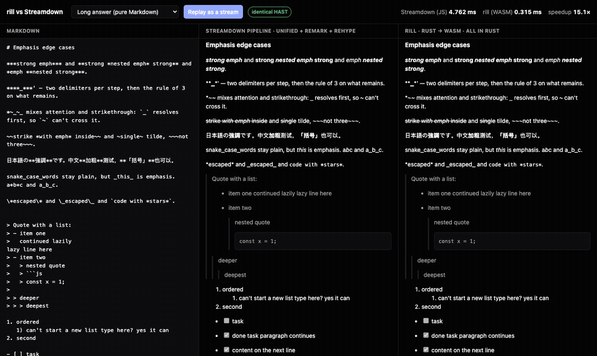

# rill

**Render AI chat Markdown 10× faster, with the exact same output.**

rill is a drop-in engine for [Streamdown](https://github.com/vercel/streamdown), the
Markdown renderer behind a lot of AI chat UIs. It's written in Rust, runs in the browser
through WebAssembly, and produces the same result as Streamdown down to every node and
character position. You get the same page, just much sooner.



## Use it

```sh
npm install @2018kguo/rill
```

Change one import:

```diff
- import { Streamdown } from "streamdown";
+ import { Streamdown } from "@2018kguo/rill/streamdown";
```

`@2018kguo/rill/streamdown` exports everything `streamdown` 2.7.1 exports, so the rest of
your imports (`Block`, `CodeBlock`, `defaultComponents`, types...) keep working from the
new path, including a `BlockComponent` of your own that wraps `Block`: import `Block`
from here too and it renders with rill. The component takes the same props and renders
the same DOM, down to every class, attribute and text node, with the same behavior
(copy and download buttons, table menus, the link safety modal, the caret, server
rendering and hydration, `components` overrides, `plugins`).

What changes is the work behind it. Streamdown is still the component: its root, its
contexts, its block splitting and memoization are its own. rill renders each block in
Rust: static markup becomes one React element with its HTML, and React only builds the
interactive parts (code block shells, tables, images, link buttons) from Streamdown's
own exported components. With `@streamdown/code`, code is tokenized by rill-highlight
(Shiki's tokenizer ported to Rust, the same tokens) in a Web Worker, and Streamdown's
streaming repair (remend) runs in Rust on just what was appended.

Anything rill doesn't reproduce exactly renders with Streamdown's own `Block`, the same
way: raw HTML that needs the HTML5 parser, `animated`, `allowedTags`, custom
`remarkPlugins`/`rehypePlugins`, `urlTransform` and the other Markdown filters,
`fallbackComponent`, and every block until the WebAssembly has loaded (and on the server
without `initRill`). `mode="static"` is Streamdown's own as well.

The other tiers stay:

- `@2018kguo/rill/react`: `useRill(plugins?)` returns `remarkPlugins`/`rehypePlugins` for
  Streamdown's own component (`<Streamdown plugins={plugins} {...useRill(plugins)}>`):
  rill parses, Streamdown's React renders.
- `@2018kguo/rill/plugins` (also exported from `/streamdown`): `rillPlugins`, the same
  plugins when you load rill yourself.

With Vite, keep the package out of dependency pre-bundling, which would move the
WebAssembly files away from the code that loads them:

```ts
// vite.config.ts
export default { optimizeDeps: { exclude: ["@2018kguo/rill"] } };
```

## Why

When a chatbot streams an answer, the screen updates many times a second. Each update
re-renders the whole answer so far, because a half-written `**bold` or table can change
meaning when the next few characters arrive. Long answers make every update slower,
and that cost lands right where users notice it: while the text is still coming in.

Streamdown does this well, but it's built from dozens of small JavaScript packages
(remark and rehype plugins) that each walk the document again. rill does the same work in
one compiled pass:

| 97 KB answer | Streamdown (JavaScript) | rill |
|---|---:|---:|
| Browser (WASM, per render) | ≈1× | 8–11× faster |
| Native (Rust) | 29.2 ms | 0.31 ms |

"Same output" is the whole point. Switching renderers usually means subtly different
lists, links or emphasis. rill is checked against Streamdown's own pipeline, so
switching changes nothing on the page.

## How it works

Rendering Markdown in Streamdown is a pipeline:

1. **Parse** the text into a syntax tree (remark, with GitHub tables and task lists,
   math, and better CJK handling).
2. **Convert** that tree into an HTML tree.
3. **Clean it up**: normalize raw HTML, strip anything unsafe, and block dangerous links.

rill reimplements all three steps in Rust, with each step ported from the JavaScript
package it replaces. Two pieces stay in JavaScript, and rill tells you when they're
needed: KaTeX for math, and the HTML5 parser for documents containing raw HTML. Plain
Markdown, which is most chat output, never touches JavaScript.

## How it was built

The parser starts from [pulldown-cmark](https://github.com/pulldown-cmark/pulldown-cmark),
a fast Rust Markdown parser. Its rules were then changed, one at a time, until they agree
with micromark, the parser Streamdown actually uses, on every input we could generate.

The method:

- **Diff against the real thing.** A harness runs Streamdown's JavaScript pipeline and
  rill on the same input and compares the trees, positions included.
- **Try every small input.** Fuzzing random documents finds bugs, but the failures are
  long and noisy. Instead, the harness enumerates *every* string up to a fixed length
  over a small set of characters like `*`, `>`, `|` and `` ` `` plus newlines. Millions
  of documents run in seconds, and each mismatch arrives as its smallest possible
  example.
- **Fix the rule, not the case.** Each minimal example was traced back to micromark's
  source to find the rule it exposed. Examples: emphasis resolves before strikethrough
  when it appears first, and a list ending inside a blockquote ends after the `>`, not
  before. Each fix is that rule written down, and the sweeps then confirm it held
  everywhere.

Today every exhaustive sweep matches exactly, across emphasis, lists and quotes, tables,
links, math and URLs, and random fuzzing over a wider vocabulary matches 99.9%. The
known differences are listed under [Conformance](#conformance).

## Try it

```sh
npm install
npm run demo          # http://localhost:4173: edit Markdown, compare both, replay a stream
```

The demo needs Rust with the `wasm32-unknown-unknown` target and
`cargo install wasm-bindgen-cli --version 0.2.129`.

---

## Reference

### Rust

```rust
use rill::{Kind, Options, Syntax};

let rendered = rill::render("# Hello *world*", &Options::default())?;
assert_eq!(rendered.kind, Kind::Complete);

let mdast_json = rill::parse_json("- [x] done", Syntax::default())?;
```

`rill::mdast::parse_arena` returns the syntax tree itself, an arena that borrows the
source text instead of copying it.

### JavaScript

`@2018kguo/rill` ships the WebAssembly prebuilt, so you don't need Rust to use it.

- `@2018kguo/rill/streamdown`: `Streamdown` and `Block`, the drop-in above, plus everything
  `streamdown` exports. `setRillHighlight(false)` keeps Shiki for code;
  `setHighlightWasm(url)` points at `rill_highlight.wasm` where a bundler can't place it.
- `@2018kguo/rill/react`: `useRill(plugins?)`, plugins for Streamdown's own component.
- `@2018kguo/rill/plugins`: `rillPlugins({ rill, plugins })` returns the `remarkPlugins`
  and `rehypePlugins` to hand `<Streamdown>`, for when you manage loading yourself (memoize
  it). `plugins` is the `plugins` prop you give `<Streamdown>` (its `math` and `cjk`);
  when the two disagree, documents render in JavaScript, with the same output. With
  `plugins.math`, rill renders each formula with its KaTeX once and caches it. It takes
  `after` for rehype plugins of your own (they run on the finished tree,
  like any plugin after Streamdown's), `maxSourceLength` (longer documents render in
  JavaScript; 128K UTF-16 units by default, since WebAssembly memory grows to fit the
  largest document and never shrinks), and `onRender` and `onError` callbacks.
- `@2018kguo/rill`: `loadRill()` fetches the WebAssembly once; `initRill(bytes)` instantiates
  it from bytes (Node, tests); `rill.render(markdown, { math, cjk })` returns `{ kind, tree }`
  directly.

```ts
import { loadRill } from "@2018kguo/rill";
import { rillPlugins } from "@2018kguo/rill/plugins";

const plugins = rillPlugins({ rill: await loadRill(), after: [rehypeSlug] });
// <Streamdown {...plugins}>{markdown}</Streamdown>
```

Three things rill can't do for you:

- **Combine its plugins with your own `remarkPlugins` or `rehypePlugins` props.** Pass
  rill's lists as they are and add rehype plugins through `after`. (A replaced
  `remarkPlugins` still renders safely, all in JavaScript.)
- **Remark plugins.** rill parses in Rust, so there is no syntax tree in JavaScript for
  them to change. Write a Rust plugin (below) or work on the HTML tree with `after`.
- **`remarkRehypeOptions`.** rill renders Streamdown's setting (`allowDangerousHtml`).
- **`allowedTags`.** Streamdown widens its sanitize schema only with its own default
  `rehypePlugins`, so with rill's the extra tags are removed.

Without rehype-raw in `rehypePlugins` (Streamdown then shows raw HTML as text), and with
`disableAutolinkProtocols` or any other remark plugin `<Streamdown>` adds, every document
renders in JavaScript.

The WebAssembly loads with `new URL("../wasm/rill_bg.wasm", import.meta.url)`, which Vite,
webpack 5, Next.js, Rollup and esbuild all resolve to a served asset.

### What runs where

| Stage | Package ported | Runs in |
|---|---|---|
| Parse | remark-parse 11, remark-gfm 4, Streamdown's remarkCodeMeta; `plugins.math`: remark-math 6 (`singleDollarTextMath: false`); `plugins.cjk`: remark-cjk-friendly 2.3 (and its strikethrough) and its autolink boundary | Rust |
| MDAST → HAST | remark-rehype 11 (`allowDangerousHtml`) | Rust |
| Raw HTML | rehype-raw 7 | Rust without raw HTML, else JavaScript |
| Sanitize | rehype-sanitize 6, Streamdown 2.7.1's schema | Rust |
| Harden | rehype-harden 1.1.8 with Streamdown's options | Rust |
| Math | `plugins.math`: rehype-katex 7 | JavaScript |

`render` reports how far it got:

- `complete`: the whole chain ran, and the tree is final.
- `raw`: the document has raw HTML (or a link inside a link), which needs parse5. Run
  rehype-raw, rehype-sanitize and rehype-harden (and with math, rehype-katex) on the tree.
- `math` (with `math` on): everything is final but the math elements, for rehype-katex,
  which Streamdown runs last.

`conformance/pipeline.mjs` has these tails ready to use.

### Options and plugins

`Options` defaults to Streamdown's setup with no `plugins` prop:

- `math`, `cjk`: Streamdown's `plugins.math` (`@streamdown/math`) and `plugins.cjk`
  (`@streamdown/cjk`).
- `harden`: link and image block policies, `Indicator` (default), `TextOnly` or `Remove`.
- `sanitize.code_classes`: extra `className`s `<code>` may keep.
- `plugins`: your transforms.

A plugin implements up to three hooks, at the points where a remark or rehype plugin
would run:

```rust
impl rill::Plugin for HeadingIds {
    // After parsing, on the syntax tree (remark plugins run here).
    fn mdast(&self, tree: &mut rill::mdast::MTree<'_>) -> Result<(), rill::Error> { Ok(()) }
    // On the HTML tree before sanitizing.
    fn hast_unsanitized(&self, tree: &mut rill::hast::HTree<'_>, root: u32, cx: &rill::Context<'_>) {}
    // On the final HTML tree (rehype plugins after the chain).
    fn hast(&self, tree: &mut rill::hast::HTree<'_>, root: u32, cx: &rill::Context<'_>) {}
}
```

`crates/rill/tests/api.rs` has a complete one that adds heading ids. Any JavaScript
rehype plugin also works unchanged on rill's output (`after` above), so a Rust plugin is
only worth it for work that has to happen earlier, such as on the syntax tree.

To ship Rust plugins, build your own WebAssembly with one export that calls
`rill::wasm::render` (the `wasm` feature) and hand it to the same JavaScript package:

```rust
use wasm_bindgen::prelude::*;

#[wasm_bindgen(js_name = renderHast)]
pub fn render_hast(source: &str, math: bool, cjk: bool) -> Result<rill::wasm::RenderedHast, JsError> {
    rill::wasm::render(source, &rill::Options { math, cjk, ..my_options() })
}
```

```ts
import init, { renderHast } from "./pkg/my_markdown.js";
import { createRill } from "@2018kguo/rill/core"; // core: no prebuilt WebAssembly
import { rillPlugins } from "@2018kguo/rill/plugins";

await init();
const plugins = rillPlugins({
  rill: createRill(renderHast),
  // The JavaScript pipeline your options mirror: the fallback, and what still runs on
  // raw HTML (all of `rehypePlugins`).
  remarkPlugins,
  rehypePlugins,
});
```

Extra arguments on your export (after `source`, `math` and `cjk`) pass through:
`createRill(renderHast)` gives `rill.render(source, { math, cjk }, ...args)`, and `rillPlugins({ args })` (required when your export
takes any) supplies them per instance.

### Conformance

```sh
cargo build --release --example stdio
node conformance/diff.mjs                                     # the examples
node conformance/diff.mjs --config math+cjk                   # with Streamdown's plugins
node conformance/diff.mjs --alphabet '~*_[]a `' --length 5    # every string over these
node conformance/diff.mjs --pieces '["- ","> ","```","\n"]' --length 6
node conformance/diff.mjs --fuzz 3000 --seed 7 --minimize     # random, with minimal witnesses
node conformance/probe.mjs '"> - a\n>"'                       # both trees side by side
```

The harness compares the MDAST (minus `data`) and the final HAST, positions included,
against Streamdown 2.7.1's pipeline, built from the published `streamdown`,
`@streamdown/math` and `@streamdown/cjk` packages, for each `plugins` configuration
(`default`, `math`, `cjk`, `math+cjk`).

Known differences, all of them position-only or in rare shapes:

- Tabs in list-item indentation count as one column where micromark expands them.
- A block that starts on a lazy line after an empty container, such as indented code
  after a bare `>`, can end one line off.
- micromark miscounts the text before a NUL byte; rill reports what U+FFFD would give.

### The drop-in component

```sh
node conformance/dom/dom-diff.mjs --build --config code          # DOM, per document
node conformance/dom/dom-diff.mjs --config code --variant prefix  # props variants
node conformance/dom/dom-diff.mjs --config code --stream every=40 # streamed prefixes
bun conformance/dom/ssr.tsx --config code                         # renderToString
node conformance/dom/interactions.mjs                             # buttons, menus, modal
node conformance/remend.mjs --fuzz 100000                         # remend against remend
```

`dom-diff.mjs` renders each document with Streamdown 2.7.1 and with rill's component in
Chromium, waits until both stop changing (highlighting included), and compares their
`innerHTML`. Configurations are `default`, `code` (`@streamdown/code`), `math`, `cjk` and
`all`; variants cover `prefix`, `controls={false}`, `linkSafety` off, `lineNumbers`
off, a `components` override, `dir="rtl"`, `mode="static"`, `caret` and a custom
`BlockComponent` around `Block`. With `--stream` it streams the chat corpus into one
root with `isAnimating`, comparing after every Nth character.

### Benchmarks

```sh
cargo run --release -p rill --example bench    # rill, native
node conformance/bench.mjs                     # the JavaScript pipeline, same document
```

### Layout

- `crates/rill-cmark`: the pulldown-cmark 0.13.4 fork, with every change from upstream
  marked `rill:`.
- `crates/rill`: `mdast.rs` (the syntax tree), `hast.rs` (HTML tree, sanitize, harden,
  plugins), `autolink.rs`, and `wasm` (the boundary the JavaScript package reads).
- `crates/rill/src/markup.rs`: Streamdown's DOM as HTML segments for the drop-in;
  `remend.rs`: remend 1.4.0.
- `crates/rill-highlight`: Shiki's TextMate tokenizer in Rust (`highlight/` builds its
  data and tests it against Shiki).
- `js/`: the `@2018kguo/rill` npm package (the drop-in component, loader, opcode
  decoder, Streamdown plugins, React hook) and its test against Streamdown's pipeline.
- `conformance/`: the differential harnesses (trees, DOM, SSR, interactions, remend), the
  probe and the benchmark.
- `demo/perf`: the main-thread benchmark (production React, CPU throttling).
- `demo/`: the page in the GIF.

## License

MIT. `crates/rill-cmark` is derived from pulldown-cmark (MIT, Copyright 2015 Google Inc.).
